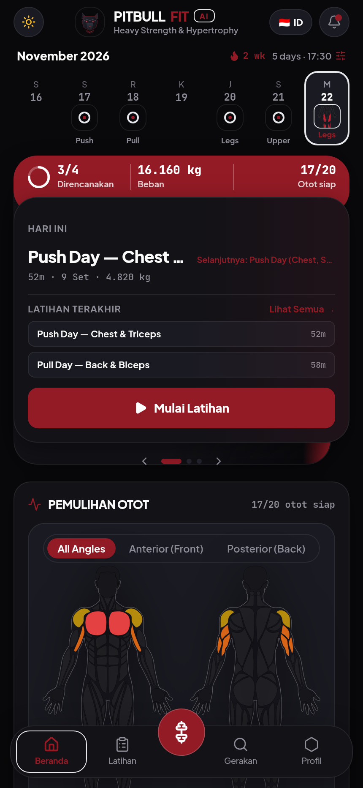
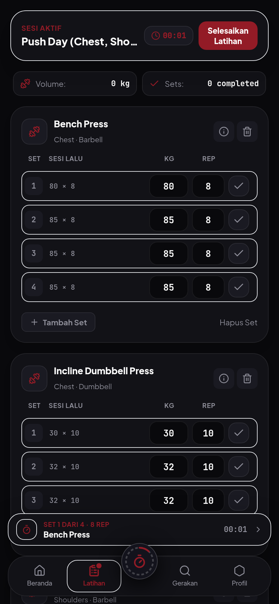
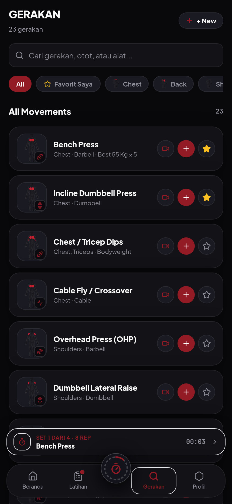
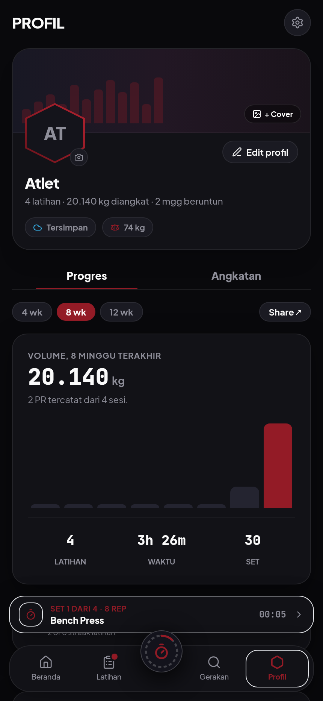

# Pitbull Fit

Aplikasi strength training untuk web dan mobile — program latihan beban, anatomi otot interaktif, rest timer, dan tracking progres. Dibangun dengan React + TypeScript, jalan sebagai PWA di browser dan sebagai app native lewat Capacitor.

**[Live demo](https://mteguhfh.github.io/pitbull-fit/)** · data disimpan lokal di browser (localStorage), tanpa backend.

<p align="center">
  
  
  
  
</p>

## Fitur

- **Program latihan** — sesi workout per hari dengan set, rep, dan beban yang bisa diatur.
- **Anatomi interaktif** — peta otot SVG yang menyala sesuai otot yang dilatih, plus status pemulihan.
- **Rest timer** — timer istirahat antar set, lengkap dengan notifikasi suara dan haptic.
- **Riwayat & progres** — volume latihan, streak mingguan, PR, dan ringkasan sesi.
- **Kalender mingguan** — pantau hari latihan dan istirahat.
- **Panduan gerakan** — modal detail dan video contoh per exercise.
- **Share story** — ekspor ringkasan sesi jadi gambar untuk dibagikan.
- **Tema gelap/terang** — tema liquid glass, plus dukungan bahasa Indonesia/Inggris.
- **PWA offline** — bisa di-install ke home screen dan tetap terbuka tanpa internet.

## Stack

React 19 · TypeScript · Vite · Tailwind CSS · Capacitor · Vitest

## Menjalankan

```bash
npm install
npm run dev        # web dev server (port 3000)
npm test           # unit test (vitest)
npm run typecheck  # cek tipe saja
npm run build      # build production ke dist/
npm run preview    # preview hasil build
```

## Build mobile

Folder `android/` dan `ios/` tidak ikut di repo. Generate dulu:

```bash
npx cap add android
npx cap add ios
npm run cap:build          # build web + cap sync
npx cap open android       # atau: npx cap open ios
```

## Struktur

```
src/
  components/   UI views & modal
  context/      state global (workout, settings)
  data/         data exercise & anatomi
  hooks/        custom hooks
  utils/        helper (i18n, bmi, format, audio)
  __tests__/    unit test
public/         manifest PWA, icon, font
docs/           screenshot
```

## Lisensi

[MIT](LICENSE)
